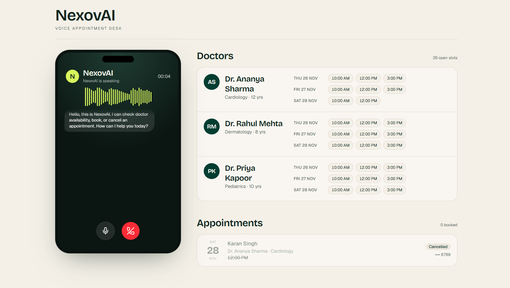

# NexovAI: Voice AI Doctor Appointment Assistant

A caller speaks to an AI agent that can check a doctor's availability, book an appointment and cancel one. The caller is identified only by the phone number they say out loud. A web dashboard lets you run the call and watch doctors, slots and appointments update live.



## Live demo

| | Link |
|---|---|
| Dashboard | https://nexovai-doctor-assistant.vercel.app |
| REST API | https://nexovai-api.onrender.com |
| Voice agent | https://nexovai-voice.onrender.com |
| Demo video | [Google Drive](https://drive.google.com/file/d/1wJt7OfCcfhVpqyBSliXk6GhtVKblBkGQ/view?usp=sharing) |

The backend runs on Render. If it has been idle, the first request can take about a minute to wake up. Open the API and voice links once, then start the call.

## Tech Stack

| Part | Choice |
|---|---|
| Voice framework | Pipecat (Python) |
| STT | ElevenLabs realtime speech-to-text |
| TTS | ElevenLabs (`eleven_flash_v2_5`) |
| **LLM** | **Groq, `llama-3.3-70b-versatile`** (free tier) |
| VAD | Silero VAD |
| Transport | SmallWebRTC |
| API and data | FastAPI + MongoDB |
| Frontend | React, Vite, TypeScript, Tailwind CSS, shadcn/ui |
| Hosting | Vercel (frontend), Render (API and voice agent) |

## How the pipeline works

```
Browser mic ──WebRTC──▶ SmallWebRTC transport
                              │
                              ▼
              ElevenLabs STT ─▶ user aggregator (Silero VAD)
                              │
                              ▼
        Groq LLM (Llama 3.3 70B) ⇄ function calls ⇄ MongoDB
                              │
                              ▼
              ElevenLabs TTS ─▶ transport ──WebRTC──▶ Browser speaker
```

The LLM has three tools registered inside the Pipecat pipeline:

| Tool | What it does |
|---|---|
| `check_doctor_availability` | Returns open future slots, optionally filtered by specialty, doctor name or date |
| `book_appointment` | Books a slot for the phone number the caller gave |
| `cancel_appointment` | Finds the caller's active appointments by phone number and cancels the one they choose |

### Safety rules built into the tools

- **Staged confirmation.** `book_appointment` and `cancel_appointment` take an `action` argument and move through steps: `prepare`, `confirm_phone`, then a final confirm. The agent reads the number back digit by digit before anything is saved.
- **A "yes" counts once.** Each confirmation must come from a new user turn after the question was asked. The tool rejects the call otherwise, so one "yes" can never confirm two steps.
- **No double booking.** A slot is claimed with an atomic `find_one_and_update`, so two callers can't take the same slot.
- **Consistent phone numbers.** Numbers are normalised (digits only, `+91` and leading `0` removed) so booking and cancelling match.
- **Times.** Stored in UTC, spoken and displayed in IST. The LLM only receives pre-formatted IST strings.

## Dashboard

- Phone-style call screen: ringing, connected and ended states, call timer, mute and end-call buttons
- Live transcript inside the phone
- Audio waveform that reacts to the caller's voice and the bot's voice
- Ring and end-call sounds
- Booking and cancellation confirmation card inside the phone
- Doctors with their open slots grouped by day
- Appointments list that updates during the call, with rows that highlight when the agent books or cancels
- Responsive layout for mobile

The dashboard polls the API every 1.5 seconds during a call (every 15 seconds otherwise) to pick up changes the agent makes.

## Project structure

```
backend/
  app/
    api/routes.py              REST endpoints for the dashboard
    core/config.py             settings from .env
    database/                  MongoDB connection and seed script
    services/                  booking, cancelling and availability logic
    voice/agent.py             Pipecat pipeline and system prompt
    voice/tools.py             function-calling tools
    main.py                    FastAPI app
frontend/
  src/
    components/                dashboard and phone UI
    hooks/                     useVoiceCall, useDashboard
    lib/                       formatting, audio levels, sounds
    services/api.ts            REST client
```

## Run locally

**You need:** Python (see `backend/.python-version`), [uv](https://docs.astral.sh/uv/), Node.js 20+, a MongoDB connection string (Atlas free tier works), an ElevenLabs API key and voice ID, and a Groq API key.

```bash
git clone https://github.com/gurwindersingh777/nexovai-doctor-assistant.git
cd nexovai-doctor-assistant
```

**Backend**

```bash
cd backend
cp .env.example .env          # Windows PowerShell: copy .env.example .env
# fill in the values in .env
uv sync
uv run python -m app.database.seed
```

Then run these in two separate terminals, both from `backend/`:

```bash
uv run uvicorn app.main:app --reload --port 8000    # REST API
uv run python -m app.voice.agent                    # voice agent on port 7860
```

**Frontend**

```bash
cd frontend
cp .env.example .env
npm install
npm run dev
```

Open http://localhost:5173, click **Try call**, allow the microphone, and try:

- "Book a cardiologist tomorrow."
- "Cancel my appointment."

## Environment variables

**`backend/.env`** (see `backend/.env.example`)

| Variable | Purpose |
|---|---|
| `MONGODB_URI` | MongoDB connection string |
| `MONGODB_DB_NAME` | Database name |
| `GROQ_API_KEY` | Groq key for the LLM |
| `ELEVENLABS_API_KEY` | ElevenLabs key for STT and TTS |
| `ELEVENLABS_VOICE_ID` | Voice used by the agent |
| `FRONTEND_URL` | Allowed CORS origin for the dashboard |

**`frontend/.env`** (see `frontend/.env.example`)

| Variable | Purpose |
|---|---|
| `VITE_API_URL` | URL of the REST API |
| `VITE_VOICE_URL` | URL of the Pipecat voice agent |

No API keys are committed. `.env` files are git-ignored.

## Limitations

- Doctors and slots are seeded mock data. The seed creates slots for the next 3 days, so re-run it to get fresh ones.
- Call state (the pending booking or cancellation) lives in memory for the duration of one call.
- The dashboard has no login and shows all appointments with masked phone numbers. It is a demo, not a production admin panel.
- Live updates use polling rather than WebSockets.

## AI usage

AI tools were used while building this project, for code review and for iterating on the UI. 